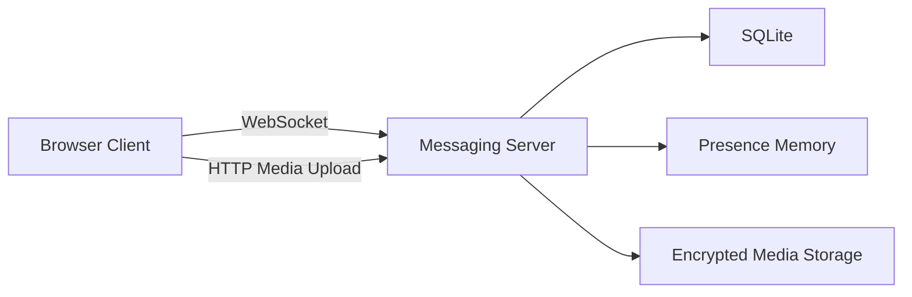
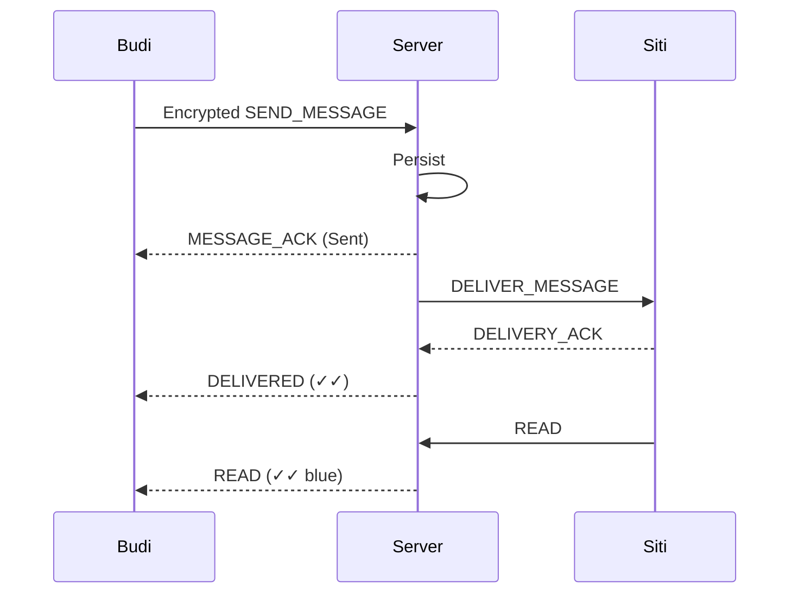

# Mini WhatsApp Distributed Messaging Architecture

A miniature distributed messaging system demonstrating the core architecture, lifecycle, and failure modes of WhatsApp-like messaging.

## Architecture



## Message flow



## Failure flow

### Sender offline

```text
Pending -> Local Outbox -> Reconnect -> Retry
```

### Server unavailable

```text
Disconnected -> Reconnect -> Retry
```

### Recipient offline

```text
Server Queue -> Recipient reconnect -> Delivery
```

### Server restart

```text
SQLite persists -> Server restarts -> Messages restored
```

## Media flow

```text
Client -> Encrypted media -> HTTP upload -> Local media storage
```

## Encryption

*Note: The crypto layer uses Web Crypto API for an educational E2EE demonstration. It is NOT a production implementation of the Signal Protocol.*
