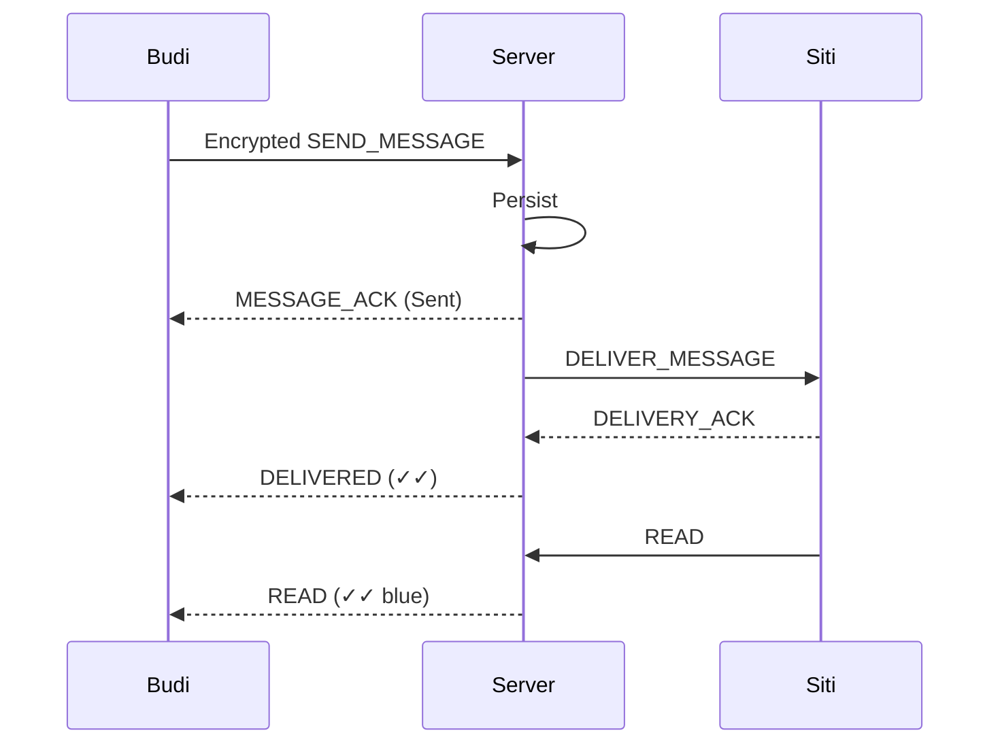

# Mini WhatsApp Distributed Messaging Architecture

A miniature distributed messaging system demonstrating the core architecture, lifecycle, and failure modes of WhatsApp-like messaging.

## Architecture

```mermaid
flowchart LR
    A[Browser Client] -->|WebSocket| B[Messaging Server]
    B --> C[SQLite]
    B --> D[Presence Memory]
    A -->|HTTP Media Upload| B
    B --> E[Media Storage (HTTP)]
```

## Message flow



## Failure flow

### Sender offline

```text
Pending -> Local Outbox -> Reconnect -> Retry
```

### Server unavailable

```text
Disconnected -> Reconnect -> Retry
```

### Recipient offline

```text
Server Queue -> Recipient reconnect -> Delivery
```

### Server restart

```text
SQLite persists -> Server restarts -> Messages restored
```

## Media flow

```text
Client -> Image file -> HTTP upload (Data Plane) -> Local media storage
```

*Note: Media files are handled on a separate HTTP Data Plane to prevent WebSocket blocking. In this educational prototype, end-to-end encryption is implemented on text payloads; media payload encryption is a planned future enhancement.*

## Encryption

*Note: The crypto layer uses the browser's native Web Crypto API (ECDH P-256 + AES-GCM 256-bit) for client-side text payload encryption. Public keys are stored and retrieved through the server without public-key infrastructure (PKI) or signature verification. It is an educational prototype and NOT a production implementation of the Signal Protocol.*
